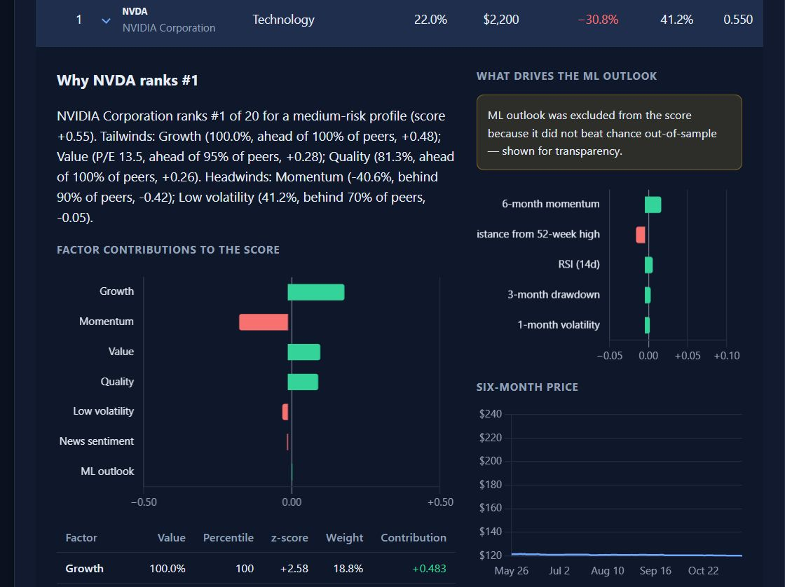
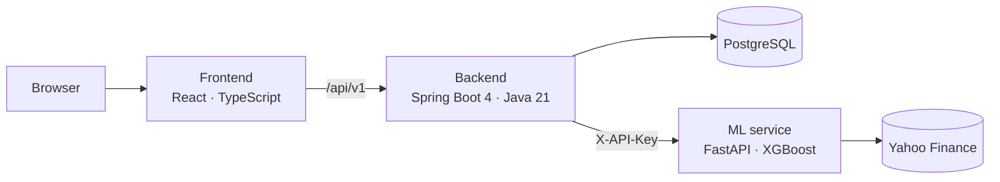

# FinSight — Explainable Portfolio Advisor

[](https://github.com/Rushi-Javiya/finsight-xai/actions/workflows/ci.yml)


Most robo-advisors tell you *what* to buy. FinSight shows you *why*. Every recommended stock comes
with an exact, additive breakdown of the factors behind its ranking, SHAP-based explanations for
the machine-learning component, and data-quality flags wherever an input was missing.



## Features

* **Explainable stock selection** — a transparent seven-factor model (momentum, low volatility,
  value, growth, quality, news sentiment, ML outlook). `score = Σ contribution`, so nothing is
  hidden.
* **Risk-aware** — LOW / MEDIUM / HIGH profiles change factor weights, position caps and
  volatility tilt.
* **Honest ML** — an XGBoost return ranker explained with SHAP and protected by an out-of-sample
  quality gate: if it can't beat chance on held-out data, it is excluded from the score and the
  UI says so.
* **Portfolio analytics** — historical return, covariance-based volatility, Sharpe, drawdown,
  diversification ratio, sector exposure.
* **Personal finance layer** — savings rate, emergency-fund target, and an age/risk based split
  across stocks, ETFs, bonds and cash.
* **Two markets** — US large caps and India NSE large caps.
* **Production practices** — typed contracts, validation, RFC 7807 errors, request tracing,
  graceful degradation, Docker, CI, 100+ automated tests.

## Architecture



See [docs/ARCHITECTURE.md](docs/ARCHITECTURE.md) for the model, quality gate and design
decisions, and [docs/API.md](docs/API.md) for the API contract.

## Quick start

### Docker (recommended)

```bash
cp .env.example .env        # set secrets
docker compose up --build
```

* App: <http://localhost:3000>
* API docs (Swagger UI): <http://localhost:8080/swagger-ui.html>

No internet access? Set `ML_MARKET_DATA_PROVIDER=synthetic` in `.env` to use deterministic
fake market data.

### Run locally

Requirements: Python 3.11+, Java 21, Node 22.

```bash
# 1. ML service  (http://localhost:8000)
cd ml-service
python -m venv .venv && source .venv/bin/activate      # Windows: .venv\Scripts\activate
pip install -r requirements-dev.txt
uvicorn app.main:app --port 8000

# 2. Backend  (http://localhost:8080, in-memory H2 by default)
cd backend
./mvnw spring-boot:run

# 3. Frontend  (http://localhost:3000, proxies /api to :8080)
cd frontend
npm install
npm run dev
```

The first recommendation per market downloads two years of prices and trains the model
(about 5–10 seconds); results are then cached for an hour.

## Try the API

```bash
curl -s localhost:8080/api/v1/advice -H 'Content-Type: application/json' -d '{
  "income": 5000, "expenses": 3000, "age": 30,
  "riskLevel": "MEDIUM", "country": "US", "topN": 8, "investmentAmount": 10000
}'
```

The response contains `financialHealth`, `assetAllocation` and `portfolio.holdings[]`, each
holding with `factors[]` (weight × z-score = contribution), `mlDrivers[]` (SHAP) and a
plain-English `explanation`.

## Configuration

| Variable | Service | Default | Purpose |
|---|---|---|---|
| `ML_MARKET_DATA_PROVIDER` | ml-service | `yahoo` | `yahoo` or `synthetic` |
| `ML_API_KEY` | ml-service, backend | *(empty)* | Shared secret for `/v1/*` |
| `ML_SNAPSHOT_TTL_SECONDS` | ml-service | `3600` | Market snapshot cache lifetime |
| `ML_RISK_FREE_RATE` | ml-service | `0.04` | Used in Sharpe ratio |
| `ML_SERVICE_URL` | backend | `http://localhost:8000` | ML service location |
| `DB_URL`, `DB_USERNAME`, `DB_PASSWORD` | backend | in-memory H2 | PostgreSQL in Docker; schema managed by Flyway |
| `CORS_ALLOWED_ORIGINS` | backend | `http://localhost:3000,http://localhost:5173` | Browser origins |
| `API_DOCS_ENABLED` | backend | `true` | Toggle Swagger UI |

## Testing

```bash
cd ml-service && pytest          # factor model, additivity, ML, portfolio, API
cd backend    && ./mvnw verify   # services, REST client, validation, integration
cd frontend   && npm test        # components, hooks, API client
```

## Project layout

```
ml-service/   FastAPI app: data providers, features, scoring, ML model, portfolio, API
backend/      Spring Boot app: controllers, services, ML client, persistence, error handling
frontend/     React + TypeScript dashboard (Vite)
docs/         API contract and architecture
.github/      CI, Dependabot, PR template
```

## Disclaimer

FinSight is an educational project and **not investment advice**. Reported returns are
historical; past performance does not predict future results.

## License

[MIT](LICENSE)
