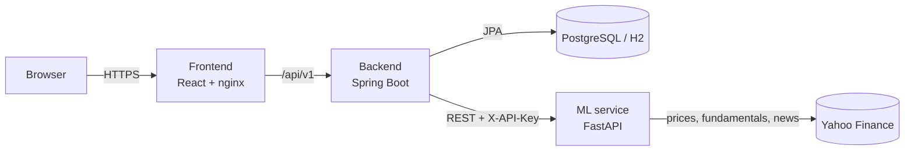

# Architecture

## Components



| Component | Responsibility | Why it is separate |
|---|---|---|
| **frontend** | Dashboard, charts, per-stock explanation views | Static assets; scales independently |
| **backend** | Public API, validation, orchestration, audit history, graceful degradation | Single trusted entry point; keeps the ML service private |
| **ml-service** | Market data, factor model, ML model, portfolio construction, explanations | Python data/ML ecosystem; can be scaled and released separately |

The backend owns deterministic personal-finance logic (savings rate, age-based asset allocation).
The ML service owns everything that depends on market data. If the ML service is down, the
backend still answers `POST /api/v1/advice` with the parts it can compute and a warning.

## Request flow for `POST /api/v1/advice`

1. The `RequestIdFilter` assigns an `X-Request-ID` that is propagated to the ML service and logs.
2. Bean validation rejects bad input with a problem document listing each field error.
3. `FinancialHealthService` and `AssetAllocationService` compute their results locally.
4. `MlServiceClient` calls `POST /v1/portfolio/recommend` (timeouts, retry on refused
   connections, error mapping). Failure becomes a `warnings[]` entry, not an error.
5. A privacy-minimal `AdviceRecord` (tickers, risk level, country, headline metrics) is saved.

## The explainable scoring model

For each stock in a universe (US large-cap or India NSE large-cap) the ML service computes:

| Factor | Raw input |
|---|---|
| Momentum | blend of 3- and 6-month return |
| Low volatility | negative 1-year annualised volatility |
| Value | earnings yield (1 / trailing P/E) |
| Growth | mean of earnings and revenue growth (clipped) |
| Quality | mean of profit margin and return on equity (clipped) |
| News sentiment | mean VADER score of recent headlines |
| ML outlook | XGBoost prediction of 21-day return relative to the universe |

Each factor is z-scored across the universe (winsorised at ±3). Missing inputs become neutral
(z = 0) and are **flagged** (`imputed`) rather than silently filled with made-up numbers.

```
score(stock)        = Σ weight[risk][factor] × z[stock][factor]
contribution(f)     = weight[risk][f] × z[f]            (shown to the user)
Σ contribution(f)   = score                             (exact, additive attribution)
```

The risk profile (LOW / MEDIUM / HIGH) selects the weight vector, e.g. LOW emphasises low
volatility and quality, HIGH emphasises momentum and growth.

### Explaining the ML component

The gradient-boosted model is explained with SHAP values (XGBoost's native `pred_contribs`), so a
user can see which technical features (momentum, RSI, drawdown, ...) pushed its prediction up or
down.

### Quality gate

A model that cannot rank held-out data better than chance should not move money. The ML service
trains on a time-ordered 75% split, purges a gap equal to the prediction horizon, and measures the
mean per-date Spearman rank correlation (rank IC) on the remaining 25%. If rank IC ≤ 0 the ML
factor's weight is set to 0, the remaining weights are renormalised, and the API reports
`model.active = false` with a data-quality note. The final model is then refit on all data purely
to produce the explanation.

### Portfolio construction

1. Take the top *N* stocks by score.
2. Weight by `exp(standardised score / temperature)`, tilted by `volatility^-k`
   (more tilt for conservative profiles).
3. Cap each position (18% / 22% / 30% for LOW / MEDIUM / HIGH) and redistribute the excess.
4. Report historical annualised return, volatility (from the covariance of daily returns),
   Sharpe ratio, max drawdown, diversification ratio, effective number of holdings and sector
   exposure.

All reported return figures are **backward-looking**.

## Operational concerns

| Concern | Approach |
|---|---|
| Latency | Per-market snapshot (prices, fundamentals, model) cached for one hour; first call ≈ 5–10 s |
| Resilience | Backend timeouts, retry on refused connections, partial responses |
| Observability | `X-Request-ID` correlation, access logs, Spring Actuator health/readiness |
| Security | ML service private + API key; CORS allow-list; RFC 7807 errors without internals |
| Reproducibility | Fixed random seeds; deterministic synthetic data provider for tests/CI |
| Configuration | Environment variables only (see `.env.example`) |

## Known limitations and next steps

* Data comes from Yahoo Finance through `yfinance`, which is unofficial and rate-limited. The
  `MarketDataProvider` protocol makes swapping in a licensed vendor a one-class change.
* The universes are fixed lists of 20 large caps; there is no user-defined universe yet.
* No authentication or per-user portfolios. Add OIDC at the backend and a user key on
  `AdviceRecord` when needed.
* Schema is managed by Hibernate `ddl-auto=update`; introduce Flyway migrations before
  production use.
* The snapshot cache is in-process; use Redis if running multiple ML replicas.
